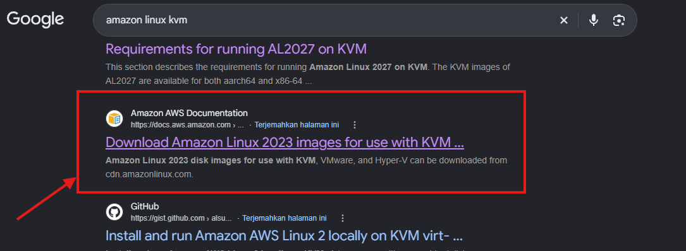
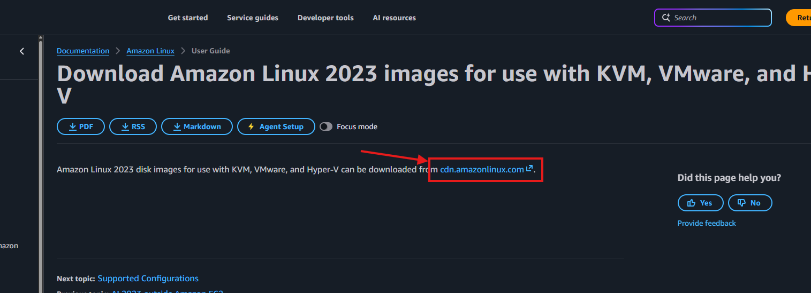
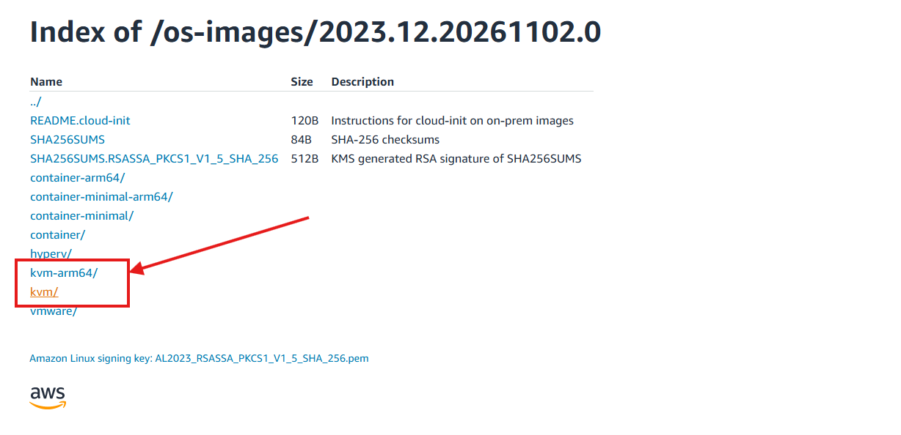
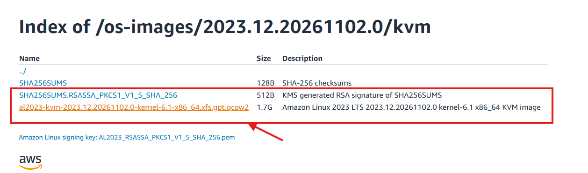

# Setting Up Virtual Machines

The first step is to create the virtual machines (VMs) that will be used in this lab. This example creates three VMs, each with 2 vCPUs and 2 GB of memory. You can change the configuration in [`main.tf`](./main.tf) and the Proxmox connection settings in [`terraform.tfvars`](./terraform.tfvars).

> [!NOTE]
> Terraform is an Infrastructure as Code (IaC) tool. It can automate the creation and management of infrastructure, including virtual machines.

## Create a Proxmox Template

The Terraform configuration clones a Proxmox VM template, so create the template before running Terraform.

This example uses Amazon Linux. Find an Amazon Linux KVM image in the [Amazon Linux documentation](https://docs.aws.amazon.com/linux/al2023/ug/amazon-linux-2023-virtual-machine.html). Proxmox systems with x86 processors generally use the `kvm` image; use `kvm-arm64` for ARM64 systems. Download the image whose filename ends in `.gpt.qcow2`.









Copy the image URL and download it to your Proxmox server. For example, open the Proxmox shell, check the current directory with `pwd`, and use `wget` with the copied URL. The ISO template directory, `/var/lib/vz/template/iso/`, is a suggested location.

Create a VM using the downloaded image and configure it for your environment. For this example, use the `q35` machine type and add an EFI disk, as the Amazon Linux image uses UEFI. Configure the CPU and other settings as needed, and make sure the VM is configured to work with cloud-init. Once the VM is ready, convert it to a template. The following recording shows an example of creating a VM template:

https://github.com/user-attachments/assets/f1373eee-99fe-4942-b4f5-818c37db0a2d

The template's Proxmox name must match the `clone_templatevm` value in `terraform.tfvars`.

## Prepare the Terraform Configuration

Run the following commands from the `setup-vm` directory.

1. Copy `terraform.tfvars.example` to `terraform.tfvars` if you have not created the file already.
2. Edit `terraform.tfvars` and provide your Proxmox API URL, API token ID and secret, target node, and template name. The values in the example file are placeholders; replace them with values for your Proxmox environment.
3. Place an SSH **public** key named `ssh-file.pub` in this directory. The configuration reads this file and adds the key to the VMs for the `ec2-user` account. Do not put a private key in this file or commit private keys or real API secrets to source control.

Review [`main.tf`](./main.tf) before applying it. It defines the Proxmox provider and its input variables, then creates `vm_count` cloned VMs. The default count is three. Each VM is configured with 2 CPU cores, 2048 MB of memory, a 64 GB disk, and an IP address in the `192.168.30.0/24` subnet. Adjust the node, network bridge, storage, IP range, and gateway in the configuration if they do not match your Proxmox environment. The `vm_ips` output lists the configured VM names and IP addresses.

## Initialize, Review, and Apply

Make sure Terraform is installed and that your workstation can reach the Proxmox API. From the `setup-vm` directory, initialize the working directory to download the required provider:

```shell
terraform init
```

Check the configuration syntax and formatting:

```shell
terraform fmt -check
terraform validate
```

Create and review an execution plan before making changes:

```shell
terraform plan -out=tfplan
```

If the plan shows the VMs and settings you expect, apply that exact plan:

```shell
terraform apply tfplan
```

Terraform displays the `vm_ips` output after a successful apply. Review the plan carefully before applying: it creates VMs on your Proxmox environment. The saved plan file may contain sensitive values, so do not commit it to source control.

To preview the changes Terraform would make later, run `terraform plan` again. To remove the VMs managed by this configuration, run `terraform destroy` from this directory and confirm the proposed changes before proceeding.
